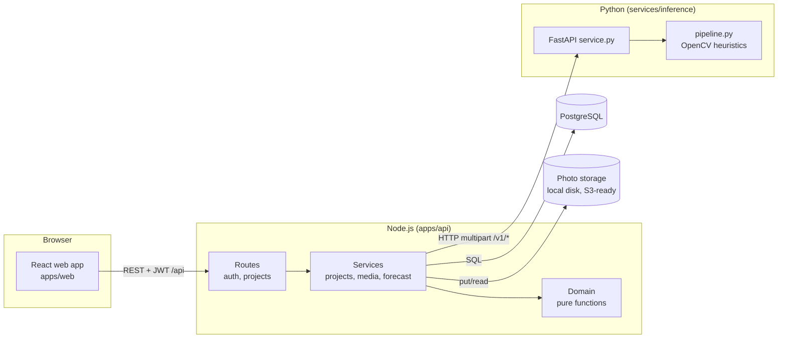
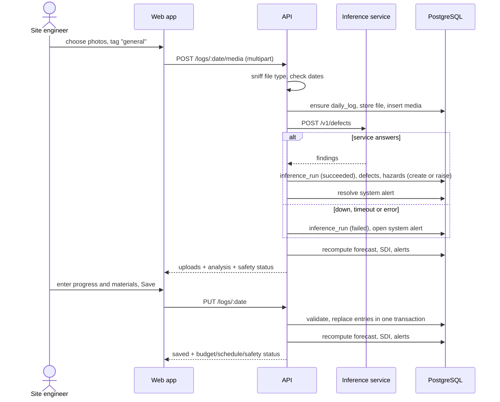
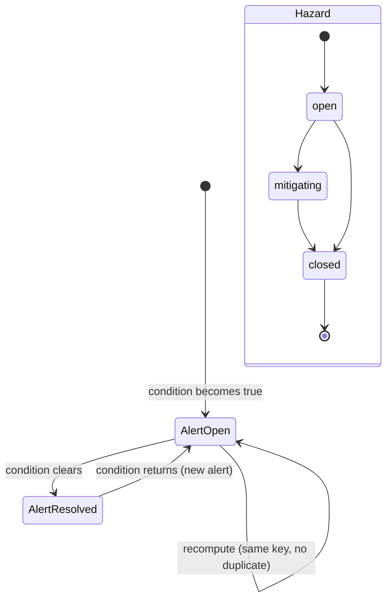

# SafelyBuild - Design (Sprint 1)

Everything in this document describes the code as it is in the repository. The ER diagram is generated from the live database ([erd.md](erd.md)) and a test fails if it drifts. Diagrams use Mermaid and render on GitHub.

## 1. Architecture



**Layers and rules**

| Layer | Folder | Rule |
|---|---|---|
| Presentation | `apps/web/src` | Renders what the API returns. No business rules, no hard-coded figures. |
| HTTP | `apps/api/src/routes`, `http.js` | Validation (zod), authentication, RBAC, audit. No arithmetic. |
| Services | `apps/api/src/services` | Combine SQL with domain functions inside transactions. |
| Domain | `apps/api/src/domain` | Pure functions: no database, no clock (dates are passed in). Every formula lives here and is unit-tested. |
| Inference | `services/inference` | Stateless: image bytes in, findings out. Never touches the database. |
| Data | `db/migrations` | The only place the schema is defined. |

## 2. Components and dependencies

| Component | File | Responsibility | Depends on |
|---|---|---|---|
| ACI mix design | `domain/aci211.js` | f'cr, w/c, water, cement, coarse and fine aggregate per m3 | none |
| Estimation | `domain/estimation.js` | BOQ to quantities and PKR cost, ACI 318 steel check | aci211 |
| Schedule generator | `domain/schedule.js` | Tasks, dates, budgets | estimation, dates |
| Earned value | `domain/evm.js` | PV/EV/AC, CPI/SPI, forecasts, series, productivity | dates |
| Risk | `domain/risk.js` | Matrix, ALARP, SDI, hazards from defects, overall safety | dates |
| Narrative | `domain/narrative.js` | Plain and technical wording, PKR formatting | none |
| Alert rules | `domain/alerts.js` | Which alerts should be open; diff vs open | narrative |
| Project service | `services/projects.js` | Projects, rates, estimate, schedule, daily logs | domain, db |
| Media service | `services/media.js` | Upload, storage, inference calls, defects, hazards, system alerts | inference.js, storage.js, risk |
| Forecast service | `services/forecast.js` | Recompute forecast, SDI, alerts; build both dashboard payloads | domain, db |
| Inference client | `inference.js` | HTTP client with timeouts and typed errors | config |
| Storage | `storage.js` | `put` / `read` by key, magic-byte sniffing, path-traversal guard | config |
| Inference service | `services/inference/service.py`, `pipeline.py` | `/v1/defects`, `/v1/activity`, `/v1/materials`, `/health` | heuristics.py, severity.py |

## 3. Interface contracts

### 3.1 REST API (all under `/api`, JSON, `Authorization: Bearer <token>`)

| Method and path | Roles | Purpose |
|---|---|---|
| `POST /auth/login` | public | email, password to token and user |
| `GET /auth/me` | any | current user |
| `POST /users`, `GET /users` | admin | manage users |
| `GET /projects`, `POST /projects` | any / admin, engineer | list accessible projects / create |
| `GET /projects/:pid` | member | project |
| `GET/POST /projects/:pid/members` | admin / staff | membership |
| `GET/PUT /projects/:pid/rates` | staff | material rates in PKR |
| `GET/POST/DELETE /projects/:pid/elements[/:eid]` | staff | BOQ |
| `POST /projects/:pid/estimates`, `GET .../estimates/active` | staff | create/activate and read the estimate |
| `POST /projects/:pid/schedule/generate`, `GET .../schedule` | staff / member | baseline schedule |
| `PUT /projects/:pid/logs/:date`, `GET .../logs`, `GET .../logs/:date` | staff / member | daily log (progress, materials) |
| `POST /projects/:pid/logs/:date/media` | staff | upload photos (multipart `files`, field `tag`) |
| `GET /media/:id/file` | member | photo bytes |
| `GET /hazard-library`, `POST /projects/:pid/hazards`, `PATCH .../hazards/:hid` | any / staff | hazards |
| `GET /projects/:pid/dashboard` | member | investor payload for investors; engineer payload for staff |
| `POST /projects/:pid/alerts/:aid/ack` | staff | acknowledge alert |
| `GET /projects/:pid/audit` | staff | audit trail |
| `GET /health` | public | database and inference status |

Errors are always `{ "error": { "code", "message", "details?" } }`: 401 unauthenticated, 403 forbidden, 404 not found (also for other tenants), 409 conflict, 422 validation, 429 rate limited.

### 3.2 Inference service (HTTP, multipart)

| Endpoint | Input | Output |
|---|---|---|
| `POST /v1/defects?backend=auto&min_violation=Medium` (backend: auto, opencv_tiles, yolo_world, crack_cnn) | `image` | `{backend, image_size, coverage, findings:[{defect_type, score, severity, is_violation, bbox, confidence, backend}]}` |
| `POST /v1/activity` | `previous`, `current` | `{change_ratio, scene_similarity, alignment_ok}` |
| `POST /v1/materials` | `image` | `{mode, simulated, proposals:[{material_code, quantity, unit, confidence}], note}` |
| `GET /health` | - | status, whether YOLO-World is installed, material provider mode |

Failures: 422 for undecodable or tiny images, 413 above 15 MB, 501 if a requested backend is not installed. The Node client treats any failure as a recorded failed run (FR-15).

## 4. Data design

The full schema is in [erd.md](erd.md) (generated). Groups:

| Group | Tables | Notes |
|---|---|---|
| Tenancy | `organizations`, `users`, `projects`, `project_members` | Roles `admin`, `engineer`, `investor`; optional PEC number on users. |
| Reference | `standards_refs`, `material_catalog`, `estimation_factors`, `productivity_rates`, `hazard_library` | Every factor records whether it is code-mandated or an editable allowance, and which standard it comes from. |
| Design and cost | `design_elements`, `project_material_rates`, `cost_estimates`, `estimate_lines` | Estimates are versioned and store the exact factors and rates used (`factors_snapshot`). |
| Schedule | `schedule_tasks`, `task_dependencies` | Task budget (`planned_cost_pkr`) sums to the active estimate. |
| Logs (the log store) | `daily_logs`, `task_progress`, `material_usage`, `media`, `inference_runs` | One log per project-day. Progress is cumulative per task. Spend rows keep a rate snapshot and a source (`manual`, `ai_confirmed`, `ai_simulated`). Raw inference responses are kept as JSONB for traceability. |
| Findings and risk | `defects`, `hazards`, `risk_scores` | `hazards.risk_rating` is a generated column (likelihood x severity). |
| Outputs | `forecasts`, `alerts`, `audit_log` | Forecast snapshots per date give the trend history. One open alert per (project, key) is enforced by a partial unique index. |

**Storage of the different data types**

| Data | Where | Why |
|---|---|---|
| Structured records, money, dates | PostgreSQL columns (NUMERIC for money, DATE for days) | Constraints and queries |
| Variable-shaped results (inference response, forecast metrics, estimate snapshot, bow-tie lists) | JSONB | Shape differs by analysis; still queryable |
| Photos | Object storage by key; DB keeps key, SHA-256, size, type, optional GPS | Keeps the database small; hash proves the file was not changed |
| Audit | Append-only table | Traceability |

## 5. Behaviour

### 5.1 Daily log and photo flow



### 5.2 Dashboard request

```mermaid
sequenceDiagram
  participant W as Web app
  participant A as API
  participant DB as PostgreSQL
  W->>A: GET /projects/:pid/dashboard
  A->>A: authenticate, check membership
  A->>DB: load tasks, progress, spend, defects, hazards
  A->>A: evaluate (EVM), computeSdi, overallSafety
  A->>DB: upsert forecast, risk score; open/resolve alerts
  alt role is investor
    A-->>W: headline, plain text, series, alerts, photos
  else engineer or admin
    A-->>W: same + indices, SDI breakdown, matrix, hazards, estimate, standards
  end
```

### 5.3 Alert and hazard states



## 6. Algorithms

### 6.1 Estimate (`domain/aci211.js`, `estimation.js`)

1. Required average strength f'cr: f'c + 7.0 (f'c under 21 MPa), f'c + 8.3 (21-35), 1.1 f'c + 5.0 (above 35) - ACI 318 margin without field history.
2. Water and entrapped air from the table for the slump 75-100 mm and maximum aggregate size (ACI 211.1).
3. w/c ratio by linear interpolation of the ACI 211.1 table for f'cr (refused outside 15-45 MPa).
4. Cement = water / (w/c). Coarse aggregate = bulk-volume fraction x dry-rodded density.
5. Sand = remaining absolute volume x specific gravity.
6. Per element: volume x mix x (1 + wastage). Cement bags = kg / 50. Sand and aggregate volumes = mass / loose bulk density (the ratio rodded/loose is the compaction factor reported to the user). Steel = volume x kg/m3 x (1 + wastage). Bricks = volume x bricks per m3 x (1 + wastage).
7. Cost = quantity x rate (PKR), rounded to paisa per line; total = sum + contingency.

### 6.2 Earned value forecast (`domain/evm.js`)

- PV(d) = sum over tasks of budget x planned fraction (working days elapsed / working days in task).
- EV(d) = sum of budget x latest recorded % / 100.
- AC(d) = sum of logged material costs up to d.
- CPI = EV / AC, SPI = EV / PV.
- EAC = BAC / CPI. Range: the other end is AC + (BAC - EV) x (cost per unit value over the last 7 log entries).
- Forecast duration = planned working days / SPI; forecast finish = project start + that many working days.
- Thresholds (constants in `THRESHOLDS`): minimum 3 logs; budget on track up to 2% over, at risk up to 10%; schedule tolerance 3% of duration (minimum 1 day), at risk up to 10%.

### 6.3 Structural Danger Index (`domain/risk.js`)

- Severity S = clamp(max defect score in last 7 days / 0.6).
- Density D = images with a violation-level defect / images analysed in the window.
- Progression P = clamp(max(0, S - S_previous_window) + 0.5 x persistence), where persistence is the share of inspection days in the window that had a violation.
- SDI = 10 x (wS S + wD D + wP P), weights by amount of inspection history (FR-19).
- Overall safety = worse of the SDI band and the worst open hazard's band (rating 1-4 low, 5-9 moderate, 10-14 high, 15+ critical).

### 6.4 Defect scoring (`services/inference`)

Rust score = fraction of ROI pixels in orange/red-brown HSV ranges. Honeycomb score = 0.6 x void-area ratio + 0.4 x normalised Laplacian roughness. Severity from score: <0.15 low, <0.35 medium, <0.60 high, otherwise critical (inherited from the POC, informed by ACI 201.1R wording). The OpenCV backend splits the image into 3x3 tiles and scores each; the optional YOLO-World backend localises regions first.

## 7. Security design

| Threat | Control |
|---|---|
| Credential guessing | bcrypt hashes, identical error for unknown user and wrong password, 5 failures per 15 minutes per email+IP |
| Cross-tenant data access | Organisation filter plus membership check in `projectAccess`; 404 hides existence; photos use the same rule |
| Privilege escalation | Role checks per route; investors blocked from all writes |
| Malicious uploads | Type decided from magic bytes, size limit, files stored under generated names, key path-traversal guard |
| Token theft after account disable | User row re-read on every request |
| Injection | Parameterised SQL only; zod validation on all bodies |

Known gaps: no HTTPS termination (deployment concern), in-memory rate limiter (single process), no refresh tokens.

## 8. Key technical decisions

| Decision | Alternative | Reason |
|---|---|---|
| Pure domain layer | Logic in routes/SQL | Every figure can be unit-tested against hand calculations |
| Earned-value method for forecasts | Linear extrapolation of spend | Separates "spent a lot" from "did a lot"; standard (ANSI/EIA-748) so investors' advisers recognise it |
| BOQ entry first | Parsing drawings | Reliable now; extraction can fill the same table later |
| Heuristic defect scoring with pluggable backends | Training a model in Sprint 1 | No labelled honeycomb data yet; interface is ready for trained weights. Cracks are the exception: SDNET2018 provided labelled data, so a MobileNetV3 model was trained and plugged in as backend `crack_cnn` ([crack-model.md](crack-model.md)) |
| Simulated material proposals flagged everywhere | Faking real detection | A fake that looks real would mislead investors |
| Generated ERD with drift test | Hand-drawn ERD | Keeps design and code identical |
| JSONB for snapshots and raw results | Many narrow tables | Shapes vary per analysis; still stored and queryable |

## 9. Design evolution from the proposal

| Proposal (Sep 2026) | Sprint 1 | Why |
|---|---|---|
| Audience: regulating council | Audience: investors and site engineers | Product pivot |
| Engineer accountability, blacklist recommendations, council decisions | Removed. PEC number kept as an optional profile field; audit log kept | Not needed for investors |
| SDI as the score shown to officials | SDI kept for engineers; investors see a 4-level traffic light and one sentence | Non-engineers need meaning, not an index |
| Risk matrices, ALARP, bow-tie "in mind" | Implemented (FR-20) | Requested to stay |
| Crack width vs PEC 0.3 mm | Crack presence is detected by a trained model and raises the "Excessive cracking" hazard; width is still deferred | Needs calibrated imagery; see crack-model.md |
| Streamlit POC (SQLite) | Moved to `services/inference`; detection code reused, SQLite replaced by PostgreSQL | The POC is now the inference engine |
| New: cost estimation, financial tracking, schedule tracking | FR-04 to FR-18 | New modules |
| MERN (MongoDB implied by name) | Express + React + PostgreSQL (as the proposal's stack list states) | Relational data fits money, dates and constraints |
