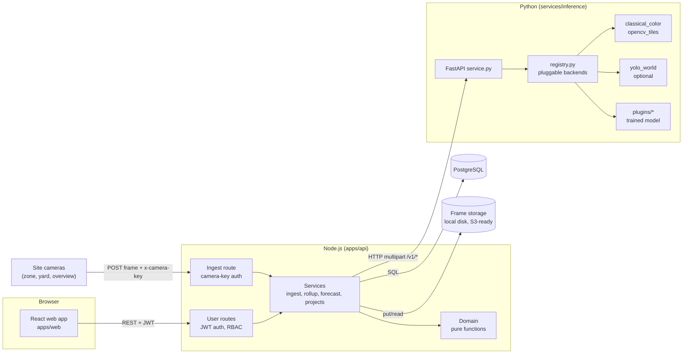
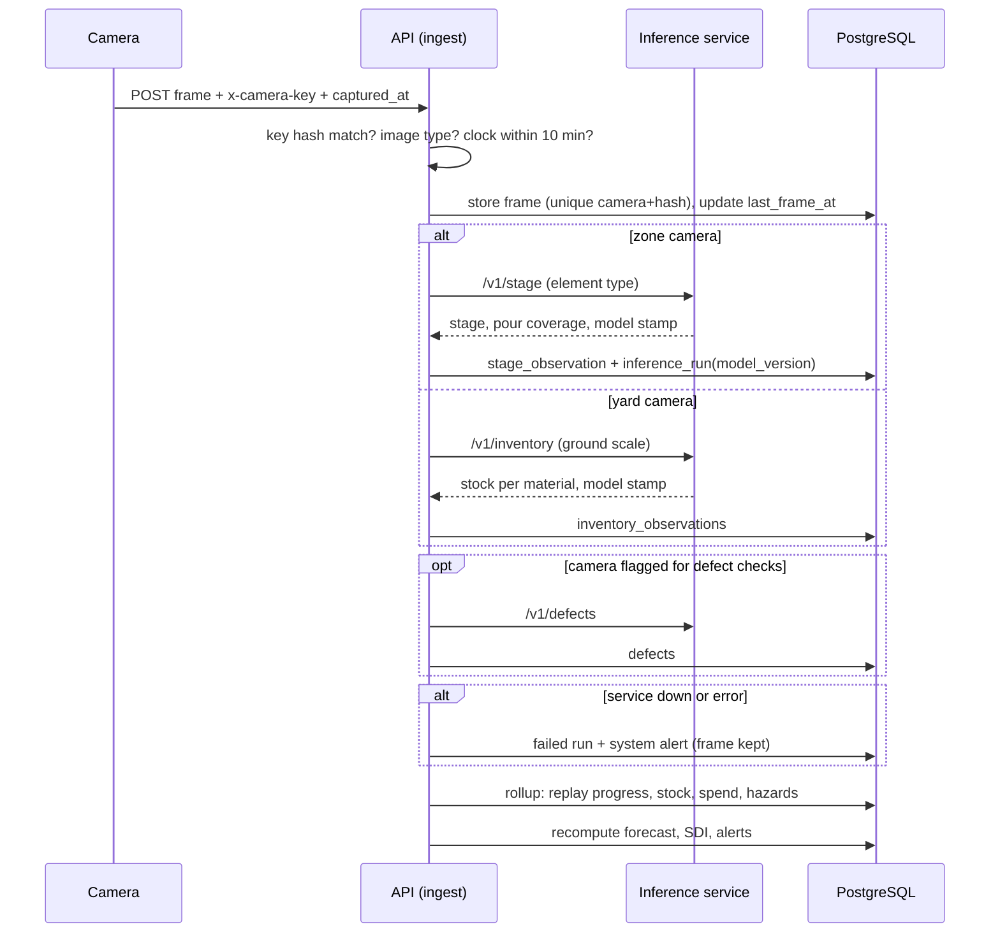
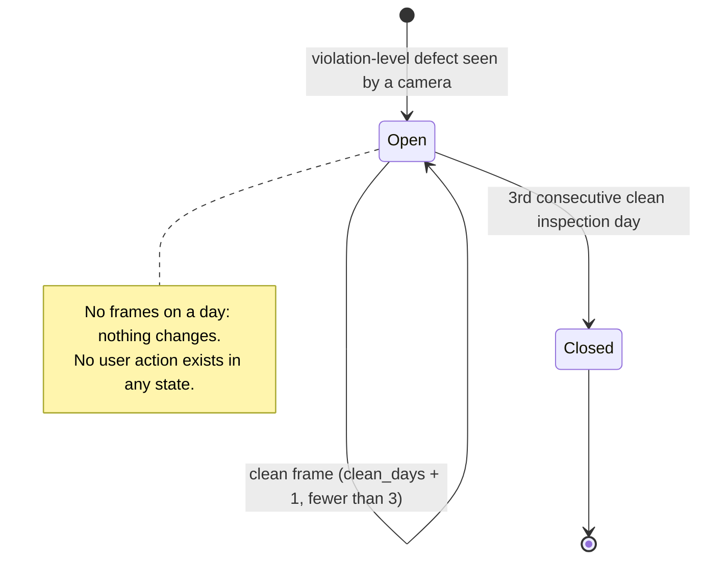

# SafelyBuild - Design

Describes the code as it is in the repository. The ER diagram is generated from the live database ([erd.md](erd.md)) and a test fails if it drifts. Diagrams use Mermaid and render on GitHub.

## 1. Architecture



**Layers and rules**

| Layer | Folder | Rule |
|---|---|---|
| Presentation | `apps/web/src` | Renders what the API returns. No business rules, no hard-coded figures, no evidence entry forms. |
| HTTP | `apps/api/src/routes`, `http.js` | Validation (zod, strict), authentication, RBAC, audit. No arithmetic. |
| Services | `apps/api/src/services` | Combine SQL with domain functions inside transactions. `rollup.js` replays observations into figures. |
| Domain | `apps/api/src/domain` | Pure functions: no database, no clock (dates are passed in). Every formula lives here and is unit-tested. |
| Inference | `services/inference` | Stateless: image in, measurement out. Backends are plug-ins behind one registry. Never touches the database. |
| Data | `db/migrations` | The only place the schema is defined. |

## 2. Components and dependencies

| Component | File | Responsibility | Depends on |
|---|---|---|---|
| ACI mix design | `domain/aci211.js` | f'cr, w/c, water, cement, aggregates per m3 | none |
| Estimation | `domain/estimation.js` | BOQ to quantities and PKR, ACI 318 steel check | aci211 |
| Schedule generator | `domain/schedule.js` | Tasks, dates, budgets | estimation, dates |
| Stages | `domain/stages.js` | Visible stage to % complete; frame agreement; ratchet | none |
| Inventory | `domain/inventory.js` | Start/end-of-day stock to consumption and deliveries | none |
| Earned value | `domain/evm.js` | PV/EV/AC, CPI/SPI, forecasts, series | dates |
| Risk | `domain/risk.js` | Matrix, ALARP, SDI, hazards derived from evidence | dates |
| Evidence health | `domain/evidence.js` | Overdue cameras, uncovered tasks | dates |
| Alerts, wording | `domain/alerts.js`, `narrative.js` | Which alerts are open; plain and technical text | evidence, narrative |
| Ingest service | `services/ingest.js` | Camera keys, frame checks, storage, analysis dispatch | inference.js, storage.js |
| Roll-up | `services/rollup.js` | Replay observations into progress, stock, spend, hazards | domain |
| Forecast service | `services/forecast.js` | Recompute forecast, SDI, alerts; build both dashboards | domain |
| Project service | `services/projects.js` | Projects, price book, estimate, schedule, site status | domain |
| Inference registry | `registry.py` | Backends per task, selection, model stamp | none |
| Analysis backends | `scene.py`, `pipeline.py`, `yolo_scene.py`, `plugins/` | stage, inventory, defects | OpenCV, optional torch |
| Evaluation | `evaluate.py` | Measure any backend on labelled images | registry |

## 3. Interface contracts

### 3.1 REST API (`/api`, JSON; user routes use `Authorization: Bearer <token>`)

| Method and path | Who | Purpose |
|---|---|---|
| `POST /ingest/frame` | **camera key** (`x-camera-key`) | multipart `image`, `captured_at`; the only way frames enter |
| `POST /auth/login`, `GET /auth/me` | public / any | sign-in |
| `POST/GET /users`, `DELETE /users/:id` | admin | manage accounts; delete is refused on yourself and across organisations |
| `GET /notifications`, `POST /notifications/:id/read`, `POST /notifications/read-all` | any (own only) | in-app notifications |
| `GET/POST /projects`, `GET /projects/:pid` | member / **engineer only** | projects (admins are notified of new ones, they do not create them) |
| `POST/GET/DELETE /projects/:pid/members[/:uid]` | admin / staff / admin | who can see the project |
| `GET /price-book`, `PUT /price-book` | any / **admin** | material prices (PKR) |
| `GET/POST/DELETE /projects/:pid/elements` | engineer, admin | BOQ (initial budget input) |
| `POST /projects/:pid/estimates`, `GET .../estimates/active` | engineer, admin | estimate and budget |
| `POST /projects/:pid/schedule/generate`, `GET .../schedule` | engineer, admin / member | baseline schedule; measured % per task |
| `PUT /projects/:pid/site-status/:date`, `GET .../site-status` | engineer, admin | **crews and equipment only** |
| `GET/POST /projects/:pid/cameras`, `PATCH .../cameras/:cid` | staff / **admin** / **admin** | camera registry |
| `GET /media/:id/file` | member | frame bytes |
| `GET /projects/:pid/dashboard` | member | investor payload for investors, engineer payload for staff |
| `POST /projects/:pid/alerts/:aid/ack`, `GET .../audit` | staff | acknowledge alert; audit trail |
| `GET /health` | public | database and inference status |

**Deliberately absent:** any route to create or change progress, material use, spend, defects, hazards or frames. Tests assert that the old Sprint 1 routes return 404 for every role.

Errors: `{ "error": { "code", "message", "details?" } }` with 401, 403, 404 (also for other tenants), 409, 422, 429.

### 3.2 Inference service (HTTP, multipart; see [model-integration.md](model-integration.md))

| Endpoint | Input | Output (all stamped with `model`) |
|---|---|---|
| `POST /v1/defects?backend=&min_violation=` | `image` | `{backend, image_size, findings[], coverage}` |
| `POST /v1/stage?element_type=&backend=` | `image` | `{stage, fraction, evidence, backend, reliability}` |
| `POST /v1/inventory?scale_m_per_px=&backend=` | `image` | `{items:[{material_code, quantity, unit, method, confidence}]}` |
| `POST /v1/activity` | `previous`, `current` | `{change_ratio, scene_similarity, alignment_ok}` |
| `GET /v1/backends`, `GET /health` | - | active backend per task, all backends and their availability |
| `POST /v1/demo/frame` | form | synthetic frame; **only when `ENABLE_DEMO_FRAMES=1`** |

`model` is `{backend, version, source, reliability, weights_sha256?, ...}`. Failures: 422 bad image or parameters, 413 too large, 501 backend missing/unavailable/not serving the task.

## 4. Data design

The full schema is in [erd.md](erd.md) (generated). Groups:

| Group | Tables | Notes |
|---|---|---|
| Tenancy | `organizations`, `users`, `projects` (`is_demo`), `project_members` | Roles `admin`, `engineer`, `investor`. |
| Reference | `standards_refs`, `material_catalog`, `estimation_factors`, `productivity_rates`, `hazard_library`, **`price_book`** | Every factor records whether it is code-mandated or an allowance and where it comes from. Prices are global and admin-maintained. |
| Design and cost | `design_elements`, `cost_estimates`, `estimate_lines` | Estimates are versioned and store the factors and prices they used. |
| Schedule | `schedule_tasks`, `task_dependencies` | Task budgets sum to the active estimate. |
| **Cameras and frames** | `cameras` (kind, element, scale, `key_hash`, `detect_defects`, `last_frame_at`), `media` (`camera_id`, `captured_at`, `received_at`, `sha256`) | Unique `(camera_id, sha256)` blocks replays. |
| **Raw observations** | `inference_runs` (with `model_version`, `model_info`, raw `result` JSONB), `stage_observations`, `inventory_observations`, `defects` | Append-only evidence from analyses. |
| **Derived (rebuilt from observations)** | `task_progress`, `inventory_daily`, `material_usage`, `hazards`, `risk_scores`, `forecasts`, `alerts` | `task_progress.source` is `image_stage`; `material_usage.source` is `image_estimate`; hazards must be `auto_defect`. |
| Engineer inputs | `daily_logs` (`crews`, `equipment`), BOQ tables | The `daily_logs` row exists for every day with frames; crews/equipment are the only fields a person fills. |
| Audit | `audit_log` (`actor_label`) | Append-only; the actor is stored as a user id (cleared if the account is deleted) and as text, so the trail keeps the name. Camera ingests record `user_id = NULL` and a `camera: <name>` label. |
| Notifications | `notifications` | One row per recipient; created in the same transaction as the event (project creation notifies every active admin of the organisation). |

**Storage of the different data types**

| Data | Where | Why |
|---|---|---|
| Structured records, money, dates | PostgreSQL columns (NUMERIC for money, DATE for days) | Constraints and queries |
| Variable-shaped results (raw model output, forecast metrics, estimate snapshot, bow-tie lists, equipment lists) | JSONB | Shape differs by model/analysis; still queryable |
| Frames | Object storage by key; DB keeps key, SHA-256, size, type, camera, capture and receive times | Small database; the hash shows the file was not altered |
| Audit | Append-only table | Traceability |

## 5. Behaviour

### 5.1 A frame becomes figures



### 5.2 Dashboard request

```mermaid
sequenceDiagram
  participant W as Web app
  participant A as API
  participant DB as PostgreSQL
  W->>A: GET /projects/:pid/dashboard
  A->>A: authenticate, check membership
  A->>DB: load tasks, progress, spend, defects, hazards, cameras, crews
  A->>A: evaluate (EVM), computeSdi, evidence health, overallSafety
  A->>DB: upsert forecast, risk score; open/resolve alerts
  alt investor
    A-->>W: headline, plain text, series, evidence note, alerts, photos
  else engineer or admin
    A-->>W: same + indices, SDI breakdown, matrix, hazards, estimate, stock, crews, camera health, latest frames
  end
```

### 5.3 Hazard lifecycle (automatic only)



An alert has the same open / resolved cycle, driven by `diffAlerts` (one open alert per condition key).

## 6. Algorithms

### 6.1 Estimate (`domain/aci211.js`, `estimation.js`)

1. Required average strength f'cr: f'c + 7.0 (f'c under 21 MPa), f'c + 8.3 (21-35), 1.1 f'c + 5.0 (above 35) - ACI 318 margin without field history.
2. Water and entrapped air for slump 75-100 mm and maximum aggregate size (ACI 211.1).
3. w/c ratio by linear interpolation of the ACI 211.1 table for f'cr (refused outside 15-45 MPa).
4. Cement = water / (w/c). Coarse aggregate = bulk-volume fraction x dry-rodded density. Sand = remaining absolute volume x specific gravity.
5. Per element: volume x mix x (1 + wastage). Bags = kg / 50. Sand and aggregate volumes = mass / loose bulk density (the ratio rodded/loose is the compaction factor reported). Steel = volume x kg/m3 x (1 + wastage). Bricks = volume x bricks per m3 x (1 + wastage).
6. Cost = quantity x price-book price (PKR), rounded per line; total = sum + contingency.

### 6.2 Progress from stages (`domain/stages.js`, `inference/scene.py`)

- The zone camera reports `stage` (what is visible) and, once concrete is visible, `fraction` (share of the element covered by concrete).
- `bounds[i]` is the % complete at which stage `i` becomes the latest visible stage (e.g. slab `[0, 15, 45, 70]`: formwork from 15 %, rebar mesh from 45 %, concrete from 70 %).
- Reported % = 0 for "nothing built"; midpoint of the range for middle stages; `bounds[last] + coverage x (100 - bounds[last])` for the concrete stage; masonry = measured wall fraction.
- A stage counts only if at least 2 frames in the last 3 days show it; the value is the one the 2nd-highest frame reaches, so a single outlier cannot move it. Progress is a ratchet (never decreases).
- Measured effect of design choices: reporting the **lower edge** of each range under-reported work done by 27 %; the **midpoint** reduced it to 9.8 %; adding **pour coverage** reduced it to 1.0 % (synthetic frames).

### 6.3 Stock, consumption and spend (`domain/inventory.js`, `scene.py`)

- Classical stock estimate: colour-class masks (sand, gravel, bags, bricks, steel), cleaned and area-counted. Sand and gravel are cones: `V = A^1.5 tan(theta) / (3 sqrt(pi))` with angle of repose 34 / 38 degrees. Bags = footprint / 0.15 m2 x 8 layers; bricks = footprint x 600 per m2; steel = footprint x 600 kg per m2. These constants are assumptions to calibrate per site.
- Consumption of a day = stock in its first frame minus stock in its last frame, ignoring changes under 2 % (noise). A delivery = today's first frame minus yesterday's last frame when the rise is above 15 % and a per-material minimum.
- Spend = consumption x price-book price, with the price frozen the first time a day is costed.
- Measured effect: using only end-of-day stock hid consumption on delivery days (spend -17.3 % vs truth); start/end-of-day frames gave -1.6 % (synthetic).

### 6.4 Earned value forecast (`domain/evm.js`)

- PV(d) = sum of task budget x planned fraction (working days elapsed / working days in task). EV(d) = sum of task budget x measured %. AC(d) = measured spend to date.
- CPI = EV / AC, SPI = EV / PV. EAC = BAC / CPI; range from the recent cost per unit of value (last 7 days). Forecast duration = planned working days / SPI.
- Thresholds in `THRESHOLDS`: at least 3 logged days; budget on track up to 2 % over, at risk up to 10 %; schedule tolerance 3 % of duration (minimum 1 day), at risk up to 10 %.

### 6.5 Structural Danger Index and hazards (`domain/risk.js`)

- Severity S = clamp(max defect score in last 7 days / 0.6). Density D = frames with a violation / frames analysed. Progression P = clamp(max(0, S - S_previous) + 0.5 x persistence). SDI = 10 x (wS S + wD D + wP P), weights 0.6/0.4/0 (first inspection day), 0.5/0.3/0.2 (fewer than 5 days), 0.4/0.3/0.3.
- `deriveHazards` walks each (camera, defect type) by date: violation opens or raises a hazard; a day the same camera was analysed with no such defect adds a clean day; 3 consecutive clean days close it; a later violation opens a new hazard. The result is stored by deleting and re-inserting the project's hazards, so the table is always a pure function of the evidence.
- Overall safety = worse of the SDI band and the worst open hazard's band; flagged `evidence_gap` when a camera is overdue.

### 6.6 Defect scoring (`pipeline.py`)

Rust score = share of ROI pixels in orange/red-brown HSV ranges. Honeycomb score = 0.6 x void-area ratio + 0.4 x normalised Laplacian roughness. Severity: <0.15 low, <0.35 medium, <0.60 high, else critical (from the POC, informed by ACI 201.1R wording). Default backend splits the frame into 3x3 tiles and scores each.

## 7. Security design

| Threat | Control |
|---|---|
| Engineer falsifies progress, spend or defects | No route exists; strict input schemas; database constraints; frames only from cameras |
| Engineer or contractor hides problems by choosing photos | Cameras submit on their own; silence is flagged (overdue, uncovered); silence never closes a hazard |
| Replaying old frames | Unique `(camera, sha256)`; clock check within 10 minutes |
| Stolen or guessed camera key | 192-bit random secret, only the hash stored, constant-time compare, per-camera disable, daily cap |
| Credential guessing | bcrypt, identical error for unknown user and wrong password, 5 failures per 15 minutes |
| Cross-tenant access | Organisation filter plus membership check; 404 hides existence; same for frames |
| Malicious uploads | Type from magic bytes, size limit, generated file names, key path-traversal guard |
| Token after account disable | User row re-read on every request |
| Injection | Parameterised SQL only; zod validation |

Known gaps: no HTTPS termination (deployment), in-memory login limiter (single process), no refresh tokens, no detection of a covered or redirected camera, the admin role is trusted (an administrator could still edit the database directly; a deployment should restrict database access and ship the audit log off the machine).

## 8. Key technical decisions

| Decision | Alternative | Reason |
|---|---|---|
| Evidence only from cameras; no human override | Engineer-editable with audit | Directly serves the product purpose: records that cannot be falsified |
| Derived tables rebuilt by replay | Incremental updates | Idempotent, cannot drift from the evidence, easy to re-run when a better model arrives |
| Model registry with plug-ins and per-task activation | Hard-wired models | A trained model can be dropped in, tried, measured and only then activated |
| Stamp every analysis with model and version | Store results only | Any figure can be traced and re-computed when models change |
| Earned-value forecasting | Linear extrapolation | Separates "spent a lot" from "did a lot"; standard (ANSI/EIA-748) |
| Stage-based progress with midpoint and pour coverage | Lower-edge stages | Measured to remove a systematic -27 % bias |
| Start/end-of-day yard frames | Daily snapshot | Measured to remove a -17 % spend error on delivery days |
| Synthetic demo frames, labelled | Faked dashboard numbers or no demo | The demo exercises the real pipeline; limits are stated everywhere |
| JSONB for raw results and snapshots | Many narrow tables | Shapes vary by model |

## 9. Design evolution from the proposal

| Proposal (Sep 2026) | Now | Why |
|---|---|---|
| Audience: regulating council | Investors and site engineers | Product pivot |
| Engineer accountability, blacklist | Removed. PEC number is an optional profile field; audit log kept | Not needed for investors |
| SDI shown to officials | SDI for engineers; investors see a 4-level light and a sentence | Non-engineers need meaning, not an index |
| Risk matrices, ALARP, bow-tie "in mind" | Implemented and automatic | Requested to stay |
| Engineer-submitted photos | **Fixed cameras only** | Engineers must not choose or alter evidence |
| Engineer-typed progress, spend and hazards (Sprint 1 first cut) | **Measured from images; no entry path** | Same reason |
| Crack width vs PEC 0.3 mm | Crack presence: trained model as an opt-in plugin ([crack-model.md](crack-model.md)); width still deferred | Needs calibrated imagery |
| Streamlit POC (SQLite) | Moved into `services/inference` as the default defect backend | The POC is now an engine |
| New modules: cost estimation, financial tracking, schedule tracking | FR-04 to FR-22 | New scope |

## 10. The evidence model and tamper-resistance

**Principle.** Whatever describes the physical state of the site (how much is built, how much material was used, what defects and hazards exist) must come from a camera and must not be editable by anyone who benefits from a good-looking record.

| Concern | Control |
|---|---|
| Who may supply evidence | Only registered cameras holding a secret key |
| Who installs cameras | Administrators only (not site engineers) |
| Editing history | No update or delete routes; derived tables rebuilt from observations; database constraints reject manual hazards |
| Choosing what to show | Cameras report on their own. Overdue cameras and uncovered tasks raise alerts; the investor sees "not verified" |
| Calling an area fixed | A hazard closes only after 3 consecutive clean inspection days measured by the same camera |
| Time tampering | Camera clock must agree with the server; each frame stores capture and receive times |
| Duplicates and replays | Unique `(camera, SHA-256)` |
| Model changes | Every analysis stores model name and version; results can be re-run |
| Who may change what | The three roles do not overlap (table below); the API enforces it, the UI only mirrors it |
| What engineers still enter | BOQ/budget, crews, equipment: visible in the audit log and clearly labelled as inputs |

**Roles (enforced by the API, tested in TC-API-ROLES).**

| | Engineer (lead engineer) | Administrator | Investor |
|---|---|---|---|
| Pages | Overview, Design & estimate, Schedule, Crews & equipment, Evidence, Risk & safety, Test footage | Summary, Cameras, Price book, Access, Audit log | Summary, Budget, Progress & schedule, Safety, Site photos |
| May write | Create project, BOQ, estimate, schedule, crews and equipment, acknowledge warnings, test footage | Install/disable cameras, price book, accounts (create, delete), project access | Nothing |
| May read | Technical status, risk and hazard detail, evidence health, price book (read-only) | Everything about system health; BOQ and schedule read-only; audit log | Plain-language figures only (no ratings, codes or controls) |
| Refused | Cameras, prices, people, audit log | BOQ, estimate, schedule, crews, warnings, test footage, creating projects | Every write; price book, cameras, BOQ |

**Open risk.** A camera can still be physically obstructed or pointed away. Not detected yet; planned as a frame-change and scene-consistency check.
