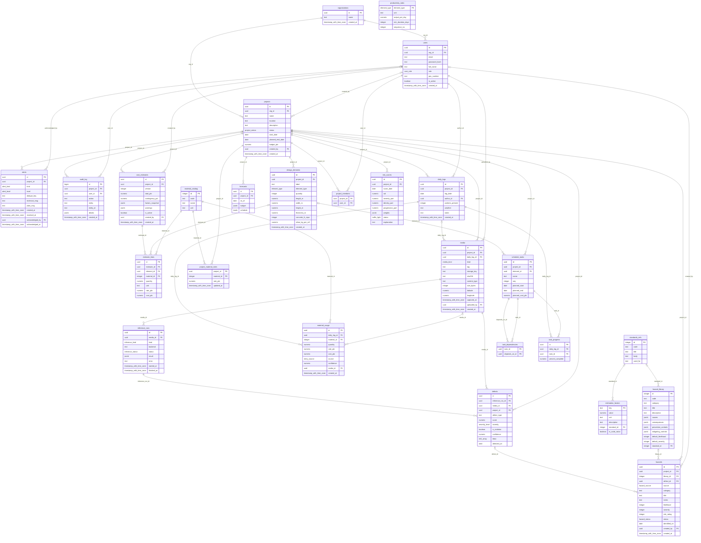

# Entity-relationship diagram (generated)

Generated from the live PostgreSQL schema by `npm run docs:erd`. Do not edit by hand: the test `schema.test.js` fails if this file drifts from the migrations.

